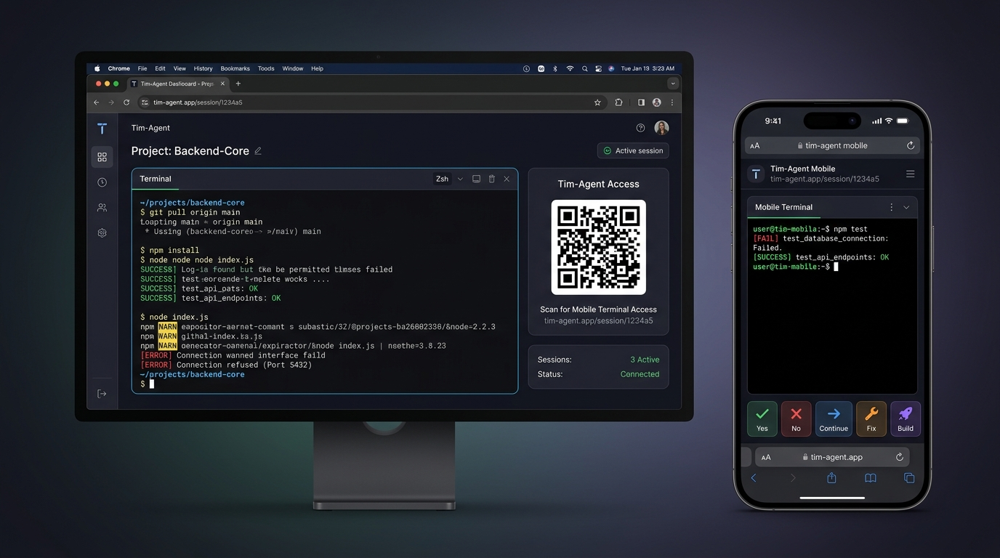

# Tim-Agent 🚀

<p align="center">
  
</p>

<p align="center">
  <strong>Native GUI Terminal Agent, Multi-Project Session Hub & Mobile Vibe Coding Companion for Claude Code, Codex, Opcode, Pi & Gemini</strong>
</p>

<p align="center">
  <a href="https://github.com/tim-today/tim-agent/actions"></a>
  <a href="https://github.com/tim-today/tim-agent/releases"></a>
  
  
  
</p>

<p align="center">
  
</p>

---

<p align="center">
  <a href="#english">English</a> | 
  <a href="#简体中文">简体中文</a> | 
  <a href="#繁體中文">繁體中文</a> | 
  <a href="#日本語">日本語</a> | 
  <a href="#한국어">한국어</a> | 
  <a href="#deutsch">Deutsch</a>
</p>

---

<a id="english"></a>
## 🇺🇸 English

### 🎯 Core Purpose & Philosophy
**Tim-Agent is purpose-built for seamless bidirectional task collaboration between Mobile Phones and PC workstations.**  
Traditional remote terminal setups are frustrating on mobile touchscreens and break connections when screens lock. Tim-Agent provides a zero-friction mobile companion terminal and multi-project session hub for your desktop workstation.

### 🌟 Why Tim-Agent?
1. 🛡️ **Zero API Token Setup & Zero Leakage Risk**: No need to provide, store, or proxy sensitive LLM API keys. Tim-Agent does not handle credentials, eliminating any risk of token leakage.
2. 📂 **Multi-Project & Multi-Session Hub**: Configure multiple projects in the Control Panel (each with its own Project Name, unique `WorkDir`, CLI Agent preset, and Auto-Approve mode). Remote connections default to your most recently active session; switching projects in the terminal top bar (`📂 Project ▾`) keeps previous project sessions running concurrently in the background.
3. 🚀 **Multi-App & Multi-Environment Zero-Plaintext Deployment (Vault)**: Configure multiple deployment applications per project (e.g., Frontend H5, Backend API, APK Build) and multiple target environments (Production, Staging, Local Test) with SSH/SCP/Rsync/FTP or custom scripts, SSH private key text pasting, one-click connection testing (`🔌 Test`), custom multi-line prompts, and ignore-file lists. Server passwords and keys are isolated inside `~/.tim-agent/vault/` (`0600` permissions, never written into your project repo). Clicking `🚀 Deploy ▾` in the terminal top bar sends a 100% zero-plaintext deployment prompt to the AI Agent.
4. 🖥️ **Desktop GUI Application & CLI Dual Mode**: In addition to command-line startup, Tim-Agent provides native double-click GUI applications for **macOS (`TimAgent.app` Universal Binary for Intel & Apple Silicon)**, **Windows (`TimAgent-windows-amd64-gui.exe` without console window)**, and **Linux (`.desktop` GUI bundle)**. Or run `tim-agent -install-app` (or click `🖥️ Generate Desktop App` in the dashboard) to create a desktop app icon in one click.
5. 💻 **Inherits 100% of Native Host Environment**: Works directly inside your local project folders. Automatically utilizes your local Git credentials, SSH keys, compiler tools, virtual environments, and shell configs.
6. 🔄 **Seamless Cross-Device Relay (Phone ↔ PC)**: Start a task at your desk, continue on your phone while walking away; approve changes on mobile, and pick up right where you left off when back at your PC.
7. ⚡ **Resilient to Network Jitter & Drops**: Decoupled from fragile SSH pipes. The host PC daemon continues executing builds, tests, and AI agent reasoning uninterrupted in the background.
8. 🤖 **Powered by Official First-Party AI Agents**: Directly drives official tools like Anthropic Claude Code CLI, OpenAI Codex CLI, and Google Gemini CLI.
9. 📲 **Progressive Web App (PWA) & Magic Mobile Keyboard**: Install as a standalone PWA on mobile, featuring a 2-row Vibe Coding toolbar (`/resume`, `/model`, magic long-press backspace to clear entire line, `0-9` & `Ctrl+` pickers) and Network-First auto-updates.

### ⚡ Quick Start (GUI App or CLI)
**Option A: Mouse Double-Click GUI Application**
Download the release package for your OS from [GitHub Releases](https://github.com/tim-today/tim-agent/releases) (`TimAgent-macos-*.app.zip`, `TimAgent-windows-amd64-gui.exe`, or `TimAgent-linux-*-gui.tar.gz`) and double-click to launch directly into the system tray and Control Panel.

**Option B: Run Instantly via Go CLI**
```bash
# 1. Run with defaults (launches dashboard & system tray)
go run github.com/tim-today/tim-agent@latest

# 2. Specify AI agent, directory, and port
go run github.com/tim-today/tim-agent@latest -agent claude -dir /path/to/project -port 20996

# 3. One-click install native Desktop GUI App (.app / .lnk / .desktop)
go run github.com/tim-today/tim-agent@latest -install-app
```

### ⚙️ Command-Line Arguments
| Flag | Type | Default | Description |
|---|---|---|---|
| `-agent` | `string` | `""` (Shell) | Default AI Agent preset (`claude`, `codex`, `opcode`, `pi`, `gemini`) |
| `-port` | `int` | `20996` | Terminal port (auto-increments if busy; admin dashboard on `20997`) |
| `-dir` | `string` | Current dir | Working directory bound to the initial project session |
| `-auto-approve` | `bool` | `false` | Auto-approve prompts / bypass sandbox for Claude Code & Codex |
| `-install-app` | `bool` | `false` | Generate and install native Desktop GUI Application icon for current OS |
| `-password` | `string` | Auto-gen | Web terminal password protection (cached after first login) |
| `-shell` | `string` | System `$SHELL` | Custom shell executable (`/bin/zsh`, `/bin/bash`, `powershell.exe`) |
| `-no-open` | `bool` | `false` | Do not automatically pop up local dashboard in browser on start |
| `-remote` | `bool` | `false` | Enable remote access to web dashboard (default localhost only, requires password) |
| `-daemon` | `bool` | `false` | Run with supervisor watchdog for auto-recovery, ensuring 24/7 port uptime |
| `-version` | `bool` | `false` | Print version information and exit |

### 🌐 Remote Access & Networking
Tim-Agent serves the shared terminal on port `20996`. For remote mobile access, we recommend:
- **[Tailscale](https://tailscale.com/) (Recommended)**: Zero-config private mesh VPN. No port forwarding needed; scan the dashboard's auto-generated QR code to connect instantly.
- **[FRP](https://github.com/fatedier/frp) / Tunneling**: Forward port `20996` through your public VPS for remote cellular access anywhere.
- **LAN (Wi-Fi)**: Direct connection within the same local network via the LAN QR code.

---

<a id="简体中文"></a>
## 🇨🇳 简体中文

### 🎯 项目初衷与核心价值
**Tim-Agent 重点解决「手机与 PC 之间的任务协同与多项目会话管理」问题。**  
开发者经常需要在手机上监控或远程处理电脑端的多个项目构建、测试任务，或与 AI 命令行 Agent（如 Claude Code CLI、Codex CLI）交互协同。传统远程终端不仅手机触屏极难操作，且断网重连与多项目切换体验极差。Tim-Agent 让手机成为电脑端多项目终端任务的最佳协同副屏。

### 🌟 项目核心特点
1. 🛡️ **无需配置 API Token，零泄密风险**：无需在网页或配置文件中填入任何大模型 API Key。Tim-Agent 本身不存储、不中转任何密钥凭据，彻底杜绝敏感信息外泄风险。
2. 📂 **多项目与多会话并行管理**：支持在后台配置界面添加多个独立项目（每个项目独立设置**项目名称**、**工作目录 `WorkDir`**、**CLI Agent 代理**、**是否自动确认**，并严格限制同一目录不可属于不同项目）。远程连接默认自动进入**最近操作的一个会话**，也可在终端顶部栏（`📂 项目名 ▾`）或控制面板一键切换到其它项目；切换后**原项目会话继续在后台保持运行**，随时切回无缝接力。
3. 🚀 **多应用与多环境零明文安全部署（Vault 凭据隔离）**：每个项目下可配置多个部署应用（如：前端H5、后端API、APK打包上传等），每个应用支持配置多个目标环境（生产、测试、本地测试），支持 SSH/SCP/Rsync/FTP 与直接粘贴 SSH 证书私钥文本、一键测试服务器连接可用性（`🔌 测试`）、自定义多行部署提示词与忽略文件列表。所有服务器账号、密码与私钥均加密隔离存储在服务端 `~/.tim-agent/vault/`（`0600` 权限，绝不写入项目目录避免误提交 Git）；在客户端终端顶栏点击 `🚀 部署 ▾` 选择应用与环境，即可向 AI 发送 100% 零明文的自动化部署指令。
4. 🖥️ **原生桌面 GUI 应用程序（鼠标双击即开）+ 命令行双模式**：除命令行直接启动外，原生支持生成 **macOS (`TimAgent.app` Intel + Apple Silicon 通用双架构)**、**Windows (`TimAgent-windows-amd64-gui.exe` 无黑框窗口)**、**Linux (`.desktop` 桌面应用)** 图形程序，鼠标双击图标直接启动常驻托盘并打开控制面板；二次双击图标会自动唤醒已运行实例的控制面板。同时支持通过 `-install-app` 参数或控制面板顶部的「🖥️ 生成桌面应用」按钮一键生成桌面应用图标。
5. 💻 **完全沿用电脑本机环境与配置**：直接工作在电脑本机的项目目录中，自动继承开发者的 Git 凭据、SSH Key、Homebrew/nvm 环境变量、编译器及终端配置。
6. 🔄 **手机 ↔ PC 多端无缝接力与双向协同**：真正实现“电脑工作做一半，出门手机继续完成；手机审批或输入一半，回工位电脑无缝接力”。
7. ⚡ **无视网络抖动，电脑多项目 Agent 独立常驻后台**：彻底告别传统 SSH 在地铁、电梯或网络切换时 Broken Pipe 导致任务中断的痛点。
8. 🤖 **采用顶级官方原生 Agent**：原生直接驱动 Anthropic 官方 Claude Code CLI、OpenAI 官方 Codex CLI、Google Gemini CLI 等原生工具。
9. 📲 **PWA 本地应用与手机端定制虚拟键盘**：支持一键安装为手机桌面独立 App（PWA），适配刘海屏安全区域确保顶栏始终可见；配备双排 Vibe Coding 快捷胶囊（含 `/resume` 恢复会话、`/model`、退格键长按连续加速删除及长按一键清空整行魔法功能）。

### ⚡ 快速开始（GUI 鼠标点开 / 命令行启动）
**方式一：鼠标双击 GUI 应用程序启动**
- 从 [GitHub Releases](https://github.com/tim-today/tim-agent/releases) 下载对应系统的 GUI 应用包（macOS 为 `TimAgent-macos-*.app.zip`，Windows 为 `TimAgent-windows-amd64-gui.exe`，Linux 为 `TimAgent-linux-*-gui.tar.gz`），或在本机编译 `make app` 生成 `bin/TimAgent.app`，直接用鼠标双击即可无黑框启动。
- 也可以在已运行的控制面板右上角点击 **「🖥️ 生成桌面应用」** 按钮，自动将程序安装到系统应用程序列表与桌面。

**方式二：通过 Go 命令行直接运行**
```bash
# 1. 默认直接运行 (自动打开控制面板并常驻系统托盘)
go run github.com/tim-today/tim-agent@latest

# 2. 传入参数启动 (指定 Agent、工作目录、端口)
go run github.com/tim-today/tim-agent@latest -agent claude -dir /path/to/project -port 20996

# 3. 一键在当前电脑生成并安装桌面 GUI 应用程序 (.app / .lnk / .desktop)
go run github.com/tim-today/tim-agent@latest -install-app
```

### ⚙️ 运行参数列表
| 参数选项 | 类型 | 默认值 | 说明 |
|---|---|---|---|
| `-agent` | `string` | `""` (系统Shell) | 默认启动的 Agent 智能体 (`claude`, `codex`, `opcode`, `pi`, `gemini`) |
| `-port` | `int` | `20996` | 终端服务监听端口（冲突自动递增；本地控制面板自动分配 `20997`） |
| `-dir` | `string` | 当前执行目录 | 绑定工作目录 (`pwd`) |
| `-auto-approve` | `bool` | `false` | 开启沙箱免确认/自动批准（自动注入 `--dangerously-skip-permissions` 等参数） |
| `-install-app` | `bool` | `false` | 一键生成并安装本机桌面 GUI 应用程序图标（支持鼠标直接点开） |
| `-password` | `string` | 自动生成强密码 | 终端访问密码保护（浏览器输入一次自动记住持久凭证） |
| `-shell` | `string` | 环境变量 `$SHELL` | 指定 Shell 解释器路径 (如 `/bin/zsh`, `powershell.exe`) |
| `-no-open` | `bool` | `false` | 启动后不自动在本地浏览器弹出控制面板 |
| `-remote` | `bool` | `false` | 允许外部IP远程访问控制面板（默认仅限本机 127.0.0.1/localhost 访问，开启需密码鉴权） |
| `-daemon` | `bool` | `false` | 开启独立 Supervisor 守护监控，异常崩溃秒级自愈重启，保证端口常驻 |
| `-version` | `bool` | `false` | 查看版本信息并退出 |

### 🌐 外网与远程网络推荐
Tim-Agent 默认在电脑端监听 `20996` 端口。需要不在电脑旁随时随地用手机访问时，推荐使用以下方案映射外网：
- **[Tailscale](https://tailscale.com/)（强烈推荐）**：私有网状 VPN，无需公网 IP 和复杂配置，手机与电脑加入同一账号后，控制面板自动生成 Tailscale 专用二维码，手机扫码秒级直连。
- **[FRP](https://github.com/fatedier/frp) / 内网穿透**：通过云服务器将电脑的 `20996` 端口映射出去，手机在任意蜂窝移动网络下皆可随时随地访问。
- **局域网 Wi-Fi**：同局域网下直接扫描控制面板的 LAN 二维码连接。

---

<a id="繁體中文"></a>
## 🇭🇰 繁體中文

### 🎯 專案初衷與核心價值
**Tim-Agent 專注於解決「手機與 PC 之間的任務協同與多專案會話管理」問題。**  
告別傳統遠端終端連線方案繁瑣脆弱的體驗，讓手機成為電腦端多專案開發任務最靈活的隨身副屏。

### 🌟 專案核心特點
1. 🛡️ **無需配置 API Token，零洩密風險**：不需在網頁或設定檔中填入任何大模型 API Key，本體不儲存、不轉發金鑰，杜絕敏感資料外洩。
2. 📂 **多專案與多會話背景並行管理**：支援在控制台配置多個獨立專案（自訂專案名稱、專屬工作目錄 `WorkDir`、CLI Agent 代理、是否自動確認，並限制同一目錄不可歸屬不同專案）。遠端預設進入**最近操作的一個會話**，也可隨時切換至其它專案，切換後**原專案會話繼續在背景保持運行**。
3. 🚀 **多應用與多環境零明文安全部署（Vault 憑證隔離）**：每個專案可配置多個部署應用（如前端H5、後端API、APK打包）與多個環境（生產、測試、本地測試），支援直接貼上 SSH 私鑰憑證文本、一鍵測試連線可用性（`🔌 測試`）、自訂多行部署提示詞與忽略檔案清單。伺服器帳號密碼與私鑰隔離存放於 `~/.tim-agent/vault/`（`0600` 權限，絕不寫入專案目錄避免誤提交 Git），在終端頂欄點擊 `🚀 部署 ▾` 即可向 AI 發送零明文自動部署指令。
4. 🖥️ **原生桌面 GUI 應用程式（滑鼠雙擊啟動）+ 命令列雙模式**：支援生成 **macOS (`TimAgent.app` Universal 雙架構)**、**Windows (`TimAgent-windows-amd64-gui.exe` 無黑框)** 與 **Linux (`.desktop`)** 桌面應用程式，滑鼠點開即用；亦可透過 `-install-app` 或控制台「🖥️ 生成桌面應用」按鈕一鍵安裝桌面圖示。
5. 💻 **完整沿用電腦本機環境與設定**：直接在電腦本機的工作目錄運行，完全承襲既有的 Git 認證、SSH Key、編譯器與終端環境。
6. 🔄 **手機 ↔ 電腦無縫雙向接力**：實現「電腦做一半，出門手機接著做；手機審批或輸入一半，回座電腦無縫接力」，跨端狀態即時同步。
7. ⚡ **無視網路抖動，電腦 Agent 獨立常駐背景**：電腦本機持續運算，重連後即時恢復互動，完全不影響既有任務。
8. 🤖 **原生採用官方頂級 Agent**：直接驅動 Anthropic Claude Code、OpenAI Codex、Google Gemini 等原廠 CLI 智能體。
9. 📲 **支援 PWA 本機應用程式與專屬虛擬鍵盤**：內建 `/resume`、`/model`、長按退格加速刪除與一鍵清空整行魔法功能，並採用 Network-First 防過期快取自動更新。

### ⚡ 快速開始
```bash
# 預設啟動（自動喚起控制台與常駐托盤）
go run github.com/tim-today/tim-agent@latest

# 一鍵生成並安裝桌面 GUI 應用程式 (.app / .lnk / .desktop)
go run github.com/tim-today/tim-agent@latest -install-app
```

### ⚙️ 執行參數說明
- `-agent`: 預設啟動的 AI Agent（支援 `claude`, `codex`, `opcode`, `pi`, `gemini`）
- `-port`: 終端服務埠號（預設 `20996`，衝突自動遞增；本地控制台為 `20997`）
- `-dir`: 綁定之工作目錄（預設當前目錄）
- `-auto-approve`: 自動確認/關閉沙箱權限提示
- `-install-app`: 一鍵生成並安裝本機桌面 GUI 應用程式圖示
- `-password`: 終端訪問密碼（瀏覽器輸入一次自動記住）
- `-shell`: 指定 Shell 路徑（如 `/bin/zsh`, `powershell.exe`）
- `-no-open`: 啟動時不自動彈出瀏覽器
- `-remote`: 允許外部IP遠端存取控制台（預設僅限本機 127.0.0.1/localhost 存取，開啟需密碼驗證）
- `-daemon`: 以 Supervisor 守護行程模式運作（自動監控與異常自愈重啟）
- `-version`: 查看版本資訊

---

<a id="日本語"></a>
## 🇯🇵 日本語

### 🎯 概要と目的
**Tim-Agent は、「スマートフォンと PC 間のシームレスなタスク協調とマルチプロジェクト管理」のために開発されました。**  
従来の遠隔ターミナルによる煩雑な設定やスマホ操作の難しさを解消し、スマートフォンを PC の最強のサブディスプレイにします。

### 🌟 主な特徴
1. 🛡️ **API トークンの設定不要・漏洩リスクゼロ**: Web や設定ファイルに API Key を入力する必要はありません。
2. 📂 **マルチプロジェクト＆マルチセッション管理**: 管理パネルで複数のプロジェクト（名前、固有の作業ディレクトリ `WorkDir`、CLI Agent、自動承認設定）を登録可能（同一ディレクトリの重複登録を防止）。リモート接続時は**直近で操作したセッション**に自動接続され、別プロジェクトへ切り替えても**元のセッションはバックグラウンドで稼働し続けます**。
3. 🚀 **マルチアプリ＆マルチ環境のゼロ平文セキュアデプロイ (Vault)**: プロジェクトごとに複数のデプロイアプリ（フロントエンド、API、APKビルド等）と複数環境（本番・ステージング・テスト）を設定可能。SSH秘密鍵テキストの直接貼り付け、ワンクリック接続テスト（`🔌 テスト`）、カスタムプロンプト、除外ファイル指定に対応。認証情報は `~/.tim-agent/vault/` (`0600`権限) に隔離保存され、ターミナル上部の `🚀 デプロイ ▾` から平文パスワードを一切出力せずに AI へデプロイ指示を送信できます。
4. 🖥️ **デスクトップ GUI アプリ（マウスでダブルクリック起動）＆ CLI 両対応**: **macOS (`TimAgent.app` Universal Binary)**、**Windows (`TimAgent-windows-amd64-gui.exe` コンソール非表示)**、**Linux (`.desktop`)** のネイティブ GUI アプリを生成可能。`-install-app` オプションまたは管理画面の「🖥️ デスクトップアプリ生成」ボタンでワンクリック作成できます。
5. 💻 **PC 本体のネイティブ環境をそのまま継承**: PC ローカルの作業ディレクトリ上で直接動作し、既存の Git 認証、SSH Key、コンパイラをそのまま利用できます。
6. 🔄 **スマホ ↔ PC のシームレスな作業リレー**: 外出先からスマホで作業を継続し、デスクに戻って PC でそのまま再開できます。
7. 🤖 **公式ファーストパーティ Agent を直接駆動**: Anthropic Claude Code、OpenAI Codex、Google Gemini などの公式 CLI ツールを直接呼び出します。
8. 📲 **PWA アプリ化とモバイル専用仮想キーボード**: `/resume` ボタンや長押し一括行削除機能付きの仮想キーボードを備え、Network-First キャッシュ制御により最新バージョンを即座に自動反映します。

### ⚡ クイックスタート
```bash
# デフォルト起動（ダッシュボードとタスクトレイが自動起動）
go run github.com/tim-today/tim-agent@latest

# デスクトップ GUI アプリ (.app / .lnk / .desktop) をワンクリック生成・インストール
go run github.com/tim-today/tim-agent@latest -install-app
```

---

<a id="한국어"></a>
## 🇰🇷 한국어

### 🎯 개요 및 핵심 목표
**Tim-Agent는 '스마트폰과 PC 간의 원활한 작업 협업 및 다중 프로젝트 세션 관리'를 위해 설계되었습니다.**  
모바일에 최적화된 가상 툴바, 다중 프로젝트 백그라운드 세션 유지, 간편한 QR 코드 연동을 통해 스마트폰을 PC 터미널의 최적 보조 화면으로 탈바꿈시킵니다.

### 🌟 핵심 장점
1. 🛡️ **API 토큰 설정 불필요 & 유출 위험 제로**: 별도의 API Key를 입력하거나 프록시하지 않습니다.
2. 📂 **다중 프로젝트 및 멀티 세션 백그라운드 유지**: 제어판에서 여러 프로젝트(프로젝트 이름, 고유 `WorkDir`, CLI Agent, 자동 승인 여부)를 설정할 수 있으며 동일 디렉토리 중복 등록을 방지합니다. 원격 접속 시 **가장 최근에 조작한 세션**으로 기본 진입하며, 다른 프로젝트로 전환해도 **기존 세션은 백그라운드에서 계속 실행**됩니다.
3. 🚀 **다중 앱 & 다중 환경 제로 평문 보안 배포 (Vault)**: 프로젝트별로 여러 배포 앱(프론트엔드 H5, 백엔드 API, APK 패키징 등)과 환경(운영, 테스트, 로컬)을 설정할 수 있으며, SSH 개인키 텍스트 직접 붙여넣기, 원클릭 연결 테스트(`🔌 테스트`), 사용자 정의 프롬프트 및 무시 파일 목록을 지원합니다. 모든 자격 증명은 `~/.tim-agent/vault/`(`0600` 권한)에 격리 저장되며, 터미널 상단 `🚀 배포 ▾` 버튼을 통해 평문 비밀번호 노출 없이 AI에게 배포 작업을 지시합니다.
4. 🖥️ **데스크톱 GUI 애플리케이션(마우스 더블클릭 실행) & CLI 이중 모드**: **macOS (`TimAgent.app` Universal Binary)**, **Windows (`TimAgent-windows-amd64-gui.exe` 콘솔창 없음)**, **Linux (`.desktop`)** GUI 앱을 지원합니다. `-install-app` 플래그나 제어판 버튼을 통해 바탕화면 아이콘을 즉시 생성할 수 있습니다.
5. 💻 **PC 본체의 로컬 환경 100% 계승**: 기존 Git 자격 증명, SSH 키, 컴파일러 설정을 그대로 사용합니다.
6. 🤖 **공식 정품 AI Agent 직접 구동**: Anthropic Claude Code, OpenAI Codex, Google Gemini 등 공식 CLI 툴을 직접 실행합니다.
7. 📲 **PWA 로컬 앱 및 모바일 맞춤형 가상 키보드**: `/resume` 세션 복구 버튼과 백스페이스 길게 눌러 줄 전체 지우기 매직 기능을 제공하며 Network-First 자동 업데이트를 지원합니다.

### ⚡ 빠른 시작
```bash
# 기본 실행 (대시보드 자동 실행 및 시스템 트레이 상주)
go run github.com/tim-today/tim-agent@latest

# 데스크톱 GUI 앱 (.app / .lnk / .desktop) 생성 및 설치
go run github.com/tim-today/tim-agent@latest -install-app
```

---

<a id="deutsch"></a>
## 🇩🇪 Deutsch

### 🎯 Zweck & Überblick
**Tim-Agent wurde für die nahtlose Zusammenarbeit und Multi-Projekt-Verwaltung zwischen Smartphone und PC entwickelt.**  
Tim-Agent verwandelt Ihr Smartphone in das ideale Begleitgerät für Ihre Desktop-Entwicklungsprojekte.

### 🌟 Kernvorteile
1. 🛡️ **Keine API-Token-Konfiguration & Null Leckagerisiko**: Keine Speicherung oder Weiterleitung geheimer API-Schlüssel.
2. 📂 **Multi-Projekt- & Multi-Session-Management**: Konfigurieren Sie mehrere Projekte (Projektname, eindeutiges `WorkDir`, CLI-Agent, Auto-Approve). Remote-Verbindungen öffnen standardmäßig die **zuletzt aktive Sitzung**; beim Wechsel zu einem anderen Projekt laufen **bisherige Projektsitzungen im Hintergrund weiter**.
3. 🚀 **Multi-App- & Multi-Umgebungs-Deployment ohne Klartext (Vault)**: Konfigurieren Sie mehrere Deployment-Anwendungen (Frontend, Backend-API, APK-Build) und Zielumgebungen (Produktion, Staging, Test) pro Projekt – inklusive direktem Einfügen von SSH-Privatschlüsseln, 1-Klick-Verbindungstest (`🔌 Test`), benutzerdefinierten Prompts und Ignore-Listen. Zugangsdaten werden isoliert unter `~/.tim-agent/vault/` (`0600`) gespeichert; ein Klick auf `🚀 Deploy ▾` in der oberen Terminalleiste übergibt dem KI-Agenten einen 100 % klartextfreien Deployment-Prompt.
4. 🖥️ **Native Desktop-GUI-Anwendung (Start per Mausklick) & CLI-Modus**: Unterstützt **macOS (`TimAgent.app` Universal Binary)**, **Windows (`TimAgent-windows-amd64-gui.exe` ohne Konsolenfenster)** und **Linux (`.desktop`)** sowie die 1-Klick-Installation über `-install-app` oder das Dashboard.
5. 💻 **Vollständige Übernahme der nativen PC-Umgebung**: Nutzt direkt Ihre lokalen Git-Anmeldedaten, SSH-Schlüssel und Compiler.
6. 🤖 **Direkte Anbindung offizieller First-Party KI-Agenten**: Unterstützt Anthropic Claude Code, OpenAI Codex und Google Gemini CLI.
7. 📲 **Progressive Web App (PWA) & Mobile Vibe-Tastatur**: Mit `/resume`-Taste, Magic-Backspace zum Löschen ganzer Zeilen bei langem Drücken und Network-First Auto-Updates.

### ⚡ Schnellstart
```bash
# Standardstart (öffnet Dashboard & verbleibt im System-Tray)
go run github.com/tim-today/tim-agent@latest

# Desktop-GUI-App (.app / .lnk / .desktop) generieren & installieren
go run github.com/tim-today/tim-agent@latest -install-app
```

---

## 📄 License

MIT License © 2026 [tim-today](https://github.com/tim-today)
