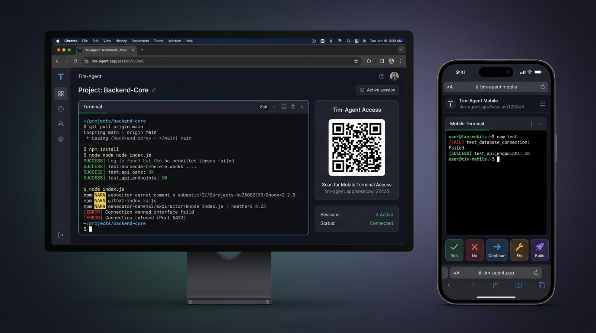

# Tim-Agent 🚀

<p align="center">
  
</p>

<p align="center">
  <strong>Zero-Install Mobile & Desktop Companion Hub for Official Claude Code, OpenAI Codex, Gemini, Opcode & Pi CLI Agents</strong><br/>
  <em>No Mobile App Required · No API Keys Required · No Cloud Server Required · 100% Authentic Official CLIs · Seamless PC ↔ Mobile Handoff · Multi-Environment Deploy Vault</em>
</p>

<p align="center">
  <a href="https://github.com/tim-today/tim-agent/actions"></a>
  <a href="https://github.com/tim-today/tim-agent/releases"></a>
  <a href="LICENSE"></a>
  
  
  
</p>

<p align="center">
  
</p>

---

<p align="center">
  <a href="#english">English</a> | 
  <a href="#日本語">日本語</a> | 
  <a href="#한국어">한국어</a> | 
  <a href="#deutsch">Deutsch</a>
</p>

---

<a id="english"></a>
## 🇺🇸 English

### 🎯 Core Philosophy: Why Tim-Agent?
When coding with AI CLI agents (`Claude Code`, `OpenAI Codex`, `Gemini CLI`, etc.), developers frequently face a painful synchronization gap between their **Desktop Workstation**, **Mobile Phone**, and **Long-Running Tasks** — walking away from your desk means losing visibility and control, while traditional mobile SSH apps are clumsy, drop connections when the screen locks, and lose session context.

**Tim-Agent solves this with a radical zero-friction architecture:**

1. 📱 **No Mobile App Installation Required**: No App Store downloads, no APK installations, and no third-party mobile client registration. Simply scan the QR code with your phone camera to take over your live terminal directly in your mobile browser (with optional 1-tap PWA home-screen install, native momentum touch scrolling for Codex/full-screen CLIs, and an ergonomic 3-row Vibe Coding touch keyboard with a versatile Ctrl/Alt/Shift multi-modifier picker).
2. 🛡️ **No API Keys or Tokens Required**: Never asks for, stores, or proxies your Anthropic, OpenAI, or Google API keys. Zero configuration overhead and zero risk of API token leakage.
3. 💻 **No Cloud Server Deployment Required**: Runs 100% locally on your own Mac, Windows, or Linux workstation (`localhost` + LAN / Tailscale). No VPS purchase, no cloud relay, and 100% inheritance of your local Git credentials, SSH keys, compilers, Docker daemon, and shell environment.
4. 🤖 **100% Authentic Official CLI Agents (Live Updates Supported)**: Directly drives official first-party CLIs (**Claude Code**, **OpenAI Codex**, **Google Gemini**, **Opcode**, **Pi**) inside a native local PTY. Whenever official CLIs release new features or updates, you update them normally and get 100% of the raw, uncompromised official experience.
5. 🔄 **Persistent Sessions & Seamless PC ↔ Mobile Bidirectional Handoff**:
   - **PC → Mobile**: Start a task on your desktop, walk away, and immediately monitor, approve prompts, or continue prompting from your phone.
   - **Mobile → PC**: Kick off or guide a task from your phone while on the go, then sit back down at your workstation and continue in the exact same live session.
   - **Multi-Project Background Keep-Alive**: Manage multiple isolated project directories (`WorkDir`). Switching projects in the top bar (`📂 Project ▾`) keeps previous project sessions running concurrently in the background, while new remote connections automatically route to your most recently active session.
6. 🚀 **Built-in Multi-Project & Multi-Environment Deploy Configuration (Zero-Plaintext Vault)**:
   - Configure multiple deployment applications per project (e.g., **Frontend Web**, **Backend API**, **Mobile APK**, **Docker**) and multiple target environments (**Production**, **Staging**, **Local Test**).
   - Supports **SSH / SCP / Rsync**, **FTP / SFTP**, and **Local Build Scripts**, direct **SSH Private Key text pasting**, **1-click connectivity & auth testing (`🔌 Test`)**, custom multi-line deploy prompts, and ignore-file lists.
   - **Zero-Plaintext Security**: Server passwords and private keys are isolated inside `~/.tim-agent/vault/` (`0600` permissions) — never written into your project repo and never printed in plaintext in the AI conversation. Clicking `🚀 Deploy ▾` in the terminal top bar lets you switch and trigger multi-environment deployments & tests anytime.

### ⚡ Quick Start (Native Desktop GUI App or CLI)

**Option A: Native Desktop GUI Application (Double-Click to Launch)**
Download the prebuilt GUI package for your OS from [GitHub Releases](https://github.com/tim-today/tim-agent/releases):
- **macOS (Universal Binary for Apple Silicon & Intel)**: `TimAgent-macos-universal.app.zip` (unzip and double-click `TimAgent.app`)
- **Windows (No Console Window)**: `TimAgent-windows-amd64-gui.exe`
- **Linux (Desktop GUI Bundle)**: `TimAgent-linux-amd64-gui.tar.gz`

**Option B: Run Instantly via Go CLI**
```bash
# 1. Launch with defaults (opens local Control Center & system tray)
go run github.com/tim-today/tim-agent@latest

# 2. Specify AI agent, project directory, and port
go run github.com/tim-today/tim-agent@latest -agent claude -dir /path/to/project -port 20996

# 3. One-click generate & install native Desktop GUI App (.app / .lnk / .desktop)
go run github.com/tim-today/tim-agent@latest -install-app
```

### ⚙️ Command-Line Arguments
| Flag | Type | Default | Description |
|---|---|---|---|
| `-agent` | `string` | `claude` | Default AI Agent preset (`claude`, `codex`, `opcode`, `pi`, `gemini`, `shell`) |
| `-port` | `int` | `20996` | Shared terminal port (auto-increments if busy; local Control Center on `20997`) |
| `-dir` | `string` | Current dir | Working directory bound to the initial project session |
| `-auto-approve` | `bool` | `false` | Auto-approve prompts / bypass sandbox for Claude Code & Codex |
| `-install-app` | `bool` | `false` | Generate and install native Desktop GUI Application icon for current OS |
| `-password` | `string` | Auto-gen | Web terminal access password (cached in browser after first login) |
| `-shell` | `string` | System `$SHELL` | Custom shell executable (`/bin/zsh`, `/bin/bash`, `powershell.exe`) |
| `-no-open` | `bool` | `false` | Do not automatically pop up local Control Center in browser on start |
| `-remote` | `bool` | `false` | Allow remote IP access to Control Center (default localhost only; requires password) |
| `-daemon` | `bool` | `false` | Run with supervisor watchdog for auto-recovery and 24/7 port uptime |
| `-version` | `bool` | `false` | Print version information and exit |

### 🌐 Remote Access Recommendations
Tim-Agent serves the shared terminal on port `20996`. To connect from your phone anywhere:
- **[Tailscale](https://tailscale.com/) (Recommended)**: Zero-config private mesh VPN. No public IP or port forwarding needed; scan the Control Center's auto-detected Tailscale QR code to connect instantly from anywhere.
- **LAN (Wi-Fi)**: Scan the LAN QR code on the same local network for zero-latency access.
- **[FRP](https://github.com/fatedier/frp) / Port Forwarding**: Forward port `20996` if you prefer custom public domain routing.

---

<a id="日本語"></a>
## 🇯🇵 日本語

### 🎯 コアコンセプト：なぜ Tim-Agent なのか？
**Tim-Agent は、PC・スマートフォン・長時間タスク間の「同期ズレや引き継ぎの分断」をゼロにするために設計されました。**

1. 📱 **スマホアプリのインストール不要**: App Store や APK のダウンロードは一切不要。スマホのカメラで QR コードを読み取るだけで、モバイルブラウザから即座にライブ端末を引き継げます（Codex/全画面CLIの慣性タッチスクロール対応、Ctrl/Alt/Shift多重選択ピッカー＆3段対称Vibe Codingタッチキーボード、PWA対応）。
2. 🛡️ **API トークン設定不要・漏洩リスクゼロ**: API キーの入力・保存・プロキシは一切不要です。
3. 💻 **クラウドサーバー構築不要**: お使いの Mac / Windows / Linux マシン上で 100% ローカル稼働し、ローカルの Git 認証や SSH 鍵、開発環境をそのまま継承します。
4. 🤖 **公式ファーストパーティ CLI Agent をそのまま駆動（随時アップデート対応）**: **Claude Code**、**OpenAI Codex**、**Google Gemini**、**Opcode**、**Pi** などの公式 CLI をネイティブ PTY で直接実行。公式ツールのアップデートにも即座に追従し、100% 本物の操作感を維持します。
5. 🔄 **永続セッション＆ PC ↔ スマホ双方向シームレス引き継ぎ**: PC で始めた作業を外出先でスマホから即座に引き継ぎ、スマホで進めた進捗をデスクに戻ってそのまま PC で再開可能。複数プロジェクトのバックグラウンド並行維持にも対応。
6. 🚀 **マルチプロジェクト＆マルチ環境デプロイ設定 (ゼロ平文 Vault)**: プロジェクトごとに複数のデプロイアプリと複数環境（本番・ステージング・テスト）を設定可能。SSH 秘密鍵テキスト貼り付け、ワンクリック接続テスト（`🔌 Test`）、カスタムプロンプト、除外ファイル指定を備え、認証情報は `~/.tim-agent/vault/` (`0600`) に安全隔離。端末上部の `🚀 Deploy ▾` から平文パスワードを一切露出せずにいつでもマルチ環境デプロイ・テストを実行できます。

### ⚡ クイックスタート
```bash
# デフォルト起動（コントロールセンターとシステムトレイを起動）
go run github.com/tim-today/tim-agent@latest

# デスクトップ GUI アプリ (.app / .lnk / .desktop) をワンクリック生成
go run github.com/tim-today/tim-agent@latest -install-app
```

---

<a id="한국어"></a>
## 🇰🇷 한국어

### 🎯 핵심 철학: 왜 Tim-Agent인가?
**Tim-Agent는 PC 워크스테이션, 스마트폰, 그리고 장시간 실행되는 AI 작업 간의 동기화 단절 문제를 완벽하게 해결합니다.**

1. 📱 **모바일 앱 설치 불필요**: 별도의 모바일 앱 다운로드 없이 스마트폰 카메라로 QR 코드만 스캔하면 모바일 브라우저에서 즉시 터미널 세션을 이어받을 수 있습니다 (Codex/전체화면 CLI 관성 터치 스크롤 지원, Ctrl/Alt/Shift 다중 선택 피커 및 인체공학적 3열 대칭 Vibe Coding 터치 키보드, PWA 지원).
2. 🛡️ **API 토큰/키 입력 불필요**: LLM API Key를 요구하거나 중계하지 않아 토큰 유출 위험이 전혀 없습니다.
3. 💻 **클라우드 서버 배포 불필요**: 사용자의 Mac / Windows / Linux PC에서 100% 로컬로 구동되며 로컬 Git 자격 증명과 개발 환경을 그대로 사용합니다.
4. 🤖 **검증된 공식 CLI Agent 100% 순정 구동 및 실시간 업데이트 호환**: **Claude Code**, **OpenAI Codex**, **Google Gemini**, **Opcode**, **Pi** 등 공식 클라이언트를 네이티브 PTY에서 직접 구동하며 공식 CLI 업데이트를 그대로 지원합니다.
5. 🔄 **세션 영구 유지 & PC ↔ 스마트폰 양방향 무중단 이어하기**: PC에서 진행하던 작업을 외출 중 스마트폰에서 바로 이어받아 승인·제어하고, 스마트폰에서 진행한 작업을 다시 PC에서 끊김 없이 이어갈 수 있습니다.
6. 🚀 **다중 프로젝트 & 다중 환경 배포 구성 (Zero-Plaintext Vault)**: 프로젝트별 다중 앱 및 다중 환경(운영/스테이징/테스트) 배포 설정, SSH 개인키 직접 붙여넣기, 원클릭 연결 테스트(`🔌 Test`), 사용자 정의 프롬프트 및 무시 파일 설정을 지원합니다. 모든 비밀번호와 키는 `~/.tim-agent/vault/`(`0600`)에 격리 저장되며 상단 `🚀 Deploy ▾` 버튼으로 언제든 안전하게 배포 및 테스트를 수행할 수 있습니다.

### ⚡ 빠른 시작
```bash
# 기본 실행 (제어 센터 및 시스템 트레이 자동 실행)
go run github.com/tim-today/tim-agent@latest

# 데스크톱 GUI 앱 (.app / .lnk / .desktop) 원클릭 생성 및 설치
go run github.com/tim-today/tim-agent@latest -install-app
```

---

<a id="deutsch"></a>
## 🇩🇪 Deutsch

### 🎯 Kernphilosophie: Warum Tim-Agent?
**Tim-Agent beseitigt die Synchronisationslücke zwischen Desktop-Workstation, Smartphone und langlaufenden KI-Entwicklungsaufgaben:**

1. 📱 **Keine Mobile-App-Installation erforderlich**: Kein App-Store-Download nötig – einfach den QR-Code scannen und direkt im mobilen Browser weiterarbeiten (inkl. nativer trägheitsgedämpfter Touch-Scroll-Unterstützung für Codex/Vollbild-CLIs, flexiblem Ctrl/Alt/Shift-Kombi-Picker und ergonomischer 3-zeiliger Vibe-Coding-Touch-Tastatur, PWA-fähig).
2. 🛡️ **Keine API-Keys oder Tokens erforderlich**: Keine Eingabe, Speicherung oder Weiterleitung sensibler LLM-API-Schlüssel.
3. 💻 **Keine Cloud-Server-Bereitstellung erforderlich**: Läuft zu 100 % lokal auf Ihrem Mac, Windows- oder Linux-PC und nutzt Ihre native Entwicklungsumgebung.
4. 🤖 **100 % originale, offizielle CLI-Agenten (inkl. Live-Updates)**: Steuert offizielle First-Party-CLIs (**Claude Code**, **OpenAI Codex**, **Google Gemini**, **Opcode**, **Pi**) direkt in einem echten lokalen PTY – volle Kompatibilität mit offiziellen CLI-Updates für ein unverfälschtes Originalerlebnis.
5. 🔄 **Dauerhafte Sitzungen & nahtlose PC ↔ Smartphone Übergabe**: Übernehmen Sie laufende PC-Aufgaben unterwegs sofort auf dem Smartphone und setzen Sie den Fortschritt vom Smartphone später nahtlos am PC fort.
6. 🚀 **Integriertes Multi-Projekt- & Multi-Umgebungs-Deployment (Zero-Plaintext Vault)**: Konfigurieren Sie mehrere Deploy-Apps und Umgebungen (Produktion, Staging, Test) pro Projekt – mit SSH-Key-Text-Einfügen, 1-Klick-Verbindungstest (`🔌 Test`), eigenen Prompts und Ignore-Listen. Zugangsdaten bleiben sicher isoliert unter `~/.tim-agent/vault/` (`0600`).

### ⚡ Schnellstart
```bash
# Standardstart (öffnet Kontrollzentrum & System-Tray)
go run github.com/tim-today/tim-agent@latest

# Desktop-GUI-App (.app / .lnk / .desktop) mit einem Klick installieren
go run github.com/tim-today/tim-agent@latest -install-app
```

---

## 📄 License

Released under the [MIT License](LICENSE) © 2026 [tim-today](https://github.com/tim-today)
